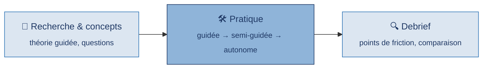
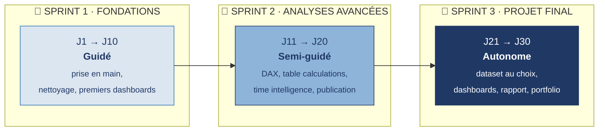
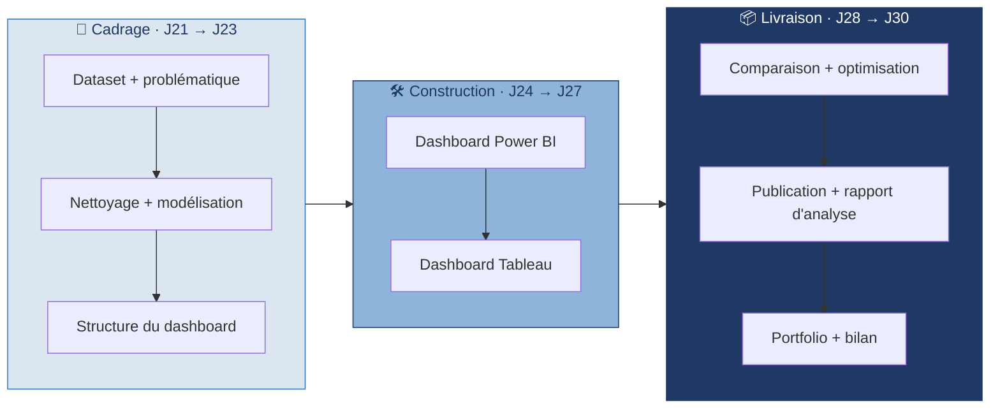

<div align="center">

# 📊 BOOTCAMP POWER BI × TABLEAU
### 30 jours pour passer d'utilisateur d'outil à Data Analyst


**Abdoulaye DJIGO**
DEV DATA P8 · Orange Digital Center · Sonatel Académie · Dakar, Sénégal

</div>

---

## Sommaire

- [Présentation](#présentation)
- [Architecture du repository](#architecture-du-repository)
- [Méthodologie](#méthodologie)
- [Progression](#progression)
- [Le projet final](#le-projet-final)
- [Stack technique](#stack-technique)
- [Utilisation](#utilisation)
- [Contact](#contact)

---

## Présentation

Bootcamp Power BI et Tableau à réaliser sur 30 jours dans le parcours de formation DEV DATA P8. Les deux outils sont appris **en parallèle** — un même concept traité à un jour d'intervalle sur chaque outil — pour développer une compétence transférable en Business Intelligence, et pas seulement la maîtrise d'un logiciel.

L'objectif final n'est pas un dashboard de démonstration, mais un **livrable professionnel** : datasets choisis, dashboards construits sur les deux outils, publiés, et documentés dans un rapport d'analyse écrit.

---

## Architecture du repository

```text
BootcampPowerBi/
│
├── 01 - SPRINT 1 - FONDATIONS (J1-10)/
│   ├── Jour 01 - Introduction DataViz/
│   ├── Jour 02 - Prise en main Power BI/
│   ├── Jour 03 - Prise en main Tableau/
│   ├── ...
│   └── Jour 10 - Bilan Sprint 1/
│
├── 02 - SPRINT 2 - ANALYSES AVANCEES (J11-20)/
│   ├── Jour 11 - Contextes de calcul/
│   ├── ...
│   └── Jour 20 - Bilan Sprint 2/
│
├── 03 - SPRINT 3 - PROJET FINAL (J21-30)/
│   ├── Jour 21 - Choix dataset et problematique/
│   ├── ...
│   └── Jour 30 - Portfolio final et bilan/
│
└── 05 - RENDUS APPRENANTS/
    └── [Un dossier par apprenant — dataset, dashboards, rapport]
```

**Structure type d'un jour :**

```text
Jour XX - Nom du theme/
├── Document de travail - Jour XX.md     # consignes, pratique, livrables
├── Data/                                # dataset du jour
└── Ressources/                          # références, aide-mémoire
```

Le préfixe numérique (`01`, `02`, `03`, `05`) fixe l'ordre d'affichage dans GitHub et dans l'explorateur de fichiers.

---

## Méthodologie

Chaque journée suit la même structure en trois temps :



**Comparaison systématique** : un même concept est traité à un jour d'intervalle sur Power BI puis Tableau. Chaque point de bascule donne lieu à une fiche mémo ou une fiche de comparaison.

---

## Progression



| Sprint | Jours | Niveau | Contenu |
|:------:|:-----:|:------:|---------|
| **1** | J1 → J10 | Guidé | Prise en main, nettoyage, premiers dashboards |
| **2** | J11 → J20 | Semi-guidé | DAX, Table Calculations, Time Intelligence, paramètres, géospatial, publication |
| **3** | J21 → J30 | Autonome | Dataset au choix, dashboards complets, rapport d'analyse, portfolio |

---

## Le projet final

Le Sprint 3 est un sprint de production. À la fin, l'apprenant livre ce qu'un analyste livre réellement — pas une présentation orale, pas des slides.



**Livrables attendus au Jour 30 :**

| Livrable | Description |
|---|---|
| Dashboard Power BI | Fonctionnel, publié sur Power BI Service |
| Dashboard Tableau | Fonctionnel, publié sur Tableau Public |
| Rapport d'analyse | Word ou PDF — contexte, méthode, résultats, recommandations, limites |
| Repository GitHub | Documenté — README, captures, liens vers les dashboards |
| Fiche de restitution | Démarche, choix techniques, bilan personnel |

---

## Stack technique


---

## Utilisation

1. **Suivre l'ordre des dossiers** `01` → `02` → `03` — chaque jour dépend du précédent
2. Chaque `Document de travail - Jour XX.md` contient : objectifs, théorie/consignes, pratique, points de friction, livrables
3. Le dataset du jour est dans le sous-dossier `Data/` correspondant
4. À partir du Jour 21, le travail personnel (dataset, fichiers `.pbix` / `.twbx`, rapport) va dans `05 - RENDUS APPRENANTS/[Votre nom]/`
5. La **Fiche Projet** créée au Jour 21 est le fil conducteur à tenir à jour jusqu'au Jour 30

---

## Contact

**Abdoulaye DJIGO**
DEV DATA P8 · Orange Digital Center · Sonatel Académie · Dakar, Sénégal